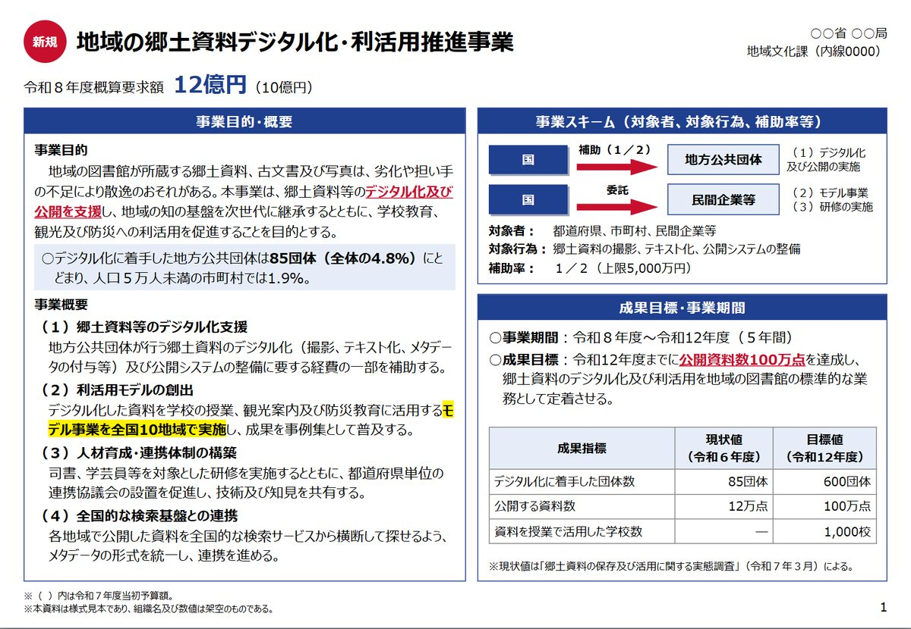
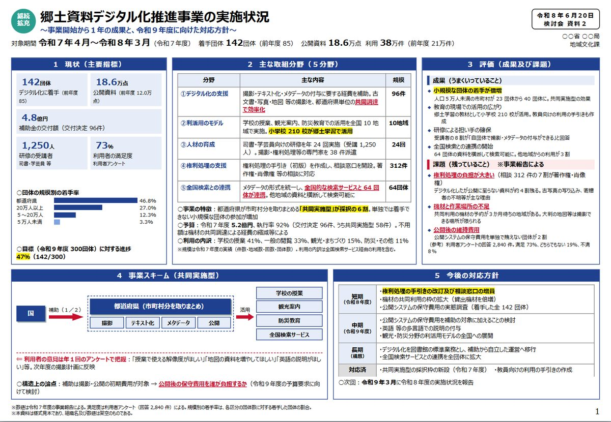
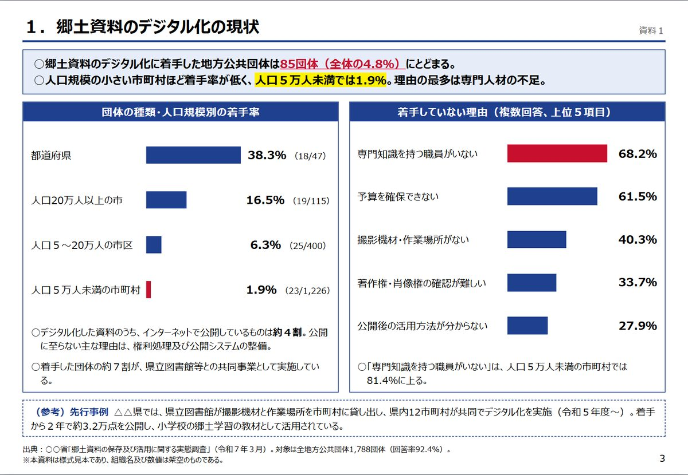

# gov-doc-style

日本の省庁（霞が関）の資料の型で、**ポンチ絵・説明資料・通知文**を作る [Claude Code](https://claude.com/claude-code) の skill です。

HTML で組んで PNG と PDF に書き出し、**はみ出し・字数・文字サイズ・書体・「等」の頻度・和暦**を、
各省の公開資料 10 本を実際に測った値（[docs/measurements.md](docs/measurements.md)）と比べて検査してから渡します。



## 作れるもの

| 種類 | ひな形 | 見本 |
|---|---|---|
| ポンチ絵（予算の事業説明型）: 事業目的・概要／事業スキーム／成果目標の 3 区画。国 →（補助）→ 地方公共団体の図 | `templates/ponchi-jigyo.html` | [画像](docs/images/ponchi-jigyo.jpg) |
| ポンチ絵（概要一覧型）: 現状・取組・評価・スキーム・今後の方針を 1 枚に全部載せる | `templates/ponchi-gaiyo.html` | [画像](docs/images/ponchi-gaiyo.jpg) |
| 複数枚の説明資料: 「資料１」の表紙・目次・本文（要点の箱、帯見出しの区画、工程表） | `templates/deck.html` | [表紙](docs/images/deck-01.jpg)・[本文](docs/images/deck-03.jpg)・[本文](docs/images/deck-04.jpg) |
| 通知文（A4 縦・記書き）: 文書番号・宛先・（公印省略）・「記」・「以上」・【本件担当】 | `templates/tsuchi.html` | [画像](docs/images/tsuchi.jpg) |

ひな形の中身はすべて架空です（組織名は「○○省」、数値も架空）。

<p>
  
  
</p>

## 使い方

### 入れる

```bash
git clone https://github.com/mouriman2/gov-doc-style ~/.claude/skills/gov-doc-style
```

必要なもの:

- [uv](https://docs.astral.sh/uv/)（初回の書き出しで依存を自動で入れます）
- Google Chrome か Microsoft Edge（書き出しに使います。ブラウザはダウンロードしません）
- 書体の Meiryo UI と MS 明朝（Windows に標準で入っています）。ほかの OS でも動きますが、書体が置き換わると検査で「注意」が出ます

### 頼む

Claude Code に、たとえば次のように頼みます。`/gov-doc-style` でも呼べます。

- 「この企画を、予算の事業説明みたいなポンチ絵 1 枚にして」
- 「今月やったことを省庁っぽい資料にまとめて」
- 「説明会のお知らせを通知文の形で作って」

Claude はひな形を書き換えて書き出し、検査の NG が無くなるまで直し、PNG を見て崩れを直してから渡します。

### 書き出しと検査だけ使う

```bash
uv run --frozen --project ~/.claude/skills/gov-doc-style gov-doc-render 資料.html
```

```text
種類: ポンチ絵（予算の事業説明型）
比べた実物: 経産省 PR 資料 789 字・15pt、財務省 862 字・13pt、厚労省 1,116 字・11.5pt

[OK  ] はみ出し      なし  （目安 なし）
[OK  ] 用紙          275×190mm  （目安 275×190mm）
[OK  ] 字数          955 字  （目安 700〜1600 字）
[OK  ] 文字サイズ    13pt（A4 換算の中央値）  （目安 11〜16pt）
[OK  ] 書体          MeiryoUI（74%）  （目安 Meiryo）
[OK  ] 下の空き      最大 5mm  （目安 8mm 以下）
[OK  ] 「等」の頻度  千字に 7.3 回  （目安 4〜15 回）
[OK  ] 年の書き方    和暦 8 回・西暦 0 回  （目安 和暦）
判定: OK
```

HTML と同じフォルダに PDF と PNG（複数枚なら `資料-01.png` …）ができます。NG があると終了コードが 1 になります。

## 検査の中身

| 項目 | 外れたとき | 測り方 |
|---|---|---|
| 枠からのはみ出し | NG | 画面上で、区画（`section`）ごとに中身が枠より大きくないか |
| 用紙・枚数 | NG | PDF の用紙の大きさと、`.page` の数 |
| 小さすぎる字 | NG | A4 に刷ったときの文字サイズの下から 5% 目 |
| 1 枚の字数・文字サイズ | 注意 | 種類ごとの目安（実物の測定値から） |
| 書体 | 注意 | 指定した書体が置き換わっていないか |
| 区画の下の空き | 注意 | 最後の字から枠の下端まで 8mm を超えていないか（省庁の資料は余白を残さない） |
| 文の途中の改行 | 注意 | HTML の中で和文の途中を改行すると、ブラウザが半角の空白を入れる |
| 「等」の頻度 | 注意 | 千字に 4〜15 回（実物の予算資料は 8.8〜11.7 回） |
| 年の書き方 | 注意 | 西暦が出ていないか（実物は和暦が慣行） |

注意は型から外れているという知らせで、わざとならそのままで構いません。

## 気をつけてほしいこと

- **実在の省庁・自治体の名義で作らないでください。** 発信者は「○○省」の伏せ字か、架空の組織か、自分の名前にしてください。公印やロゴは入れません。本物の通知と見分けがつかない文書は作りません
- 分からない数字は「○億円」のように伏せます。数字を作らせないでください
- PowerPoint（.pptx）は出しません。直したいときは HTML を直して書き出し直します
- この skill は個人が作ったもので、どの省庁とも関係ありません

## 開発

```bash
uv run --frozen pytest
uv run --frozen ruff format . && uv run --frozen ruff check . --fix && uv run --frozen pyright
```

`tests/test_templates.py` は、ひな形 4 枚をそのまま書き出して検査が OK になることを確かめます（Chrome か Edge が要ります。無ければ飛ばします）。

| 場所 | 役目 |
|---|---|
| `SKILL.md` | Claude が読む手順 |
| `references/style-guide.md` | 書き方の決まり（文体・記号・数字・詰め方・HTML の注意） |
| `templates/*.html` | ひな形 4 枚。どれも検査が OK になる完成品 |
| `src/gov_doc_style/render.py` | `gov-doc-render`。Playwright で手元の Chrome を動かし、画面上の検査 → PNG → PDF |
| `src/gov_doc_style/measure.py` | PDF を測る（pdfplumber。字数・A4 換算の文字サイズ・書体・「等」・和暦） |
| `src/gov_doc_style/specs.py` | 種類ごとの目安と、NG／注意の判定 |
| `docs/measurements.md` | 目安の根拠（実物 10 本の測定値と出典） |

ひな形を直したら `pytest` を回してください。目安から外れたときは、目安を動かすのではなく、ひな形の中身を直します（目安は実物の測定値が根拠です）。

## ライセンス

[MIT](LICENSE)
